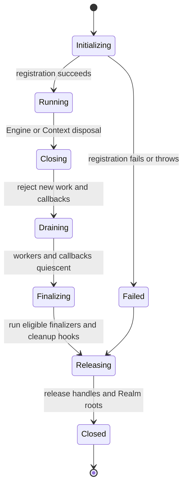

# Node-API environment lifecycle

## State machine

## Environment ownership

One environment belongs to one Engine heap, Realm, owner thread, and module
registration. It cannot migrate to another Engine or be used after `Closing`
begins except by APIs explicitly permitted during cleanup.

## Scope and reference shutdown

At shutdown:

1. Stop accepting callbacks, references, async work, and thread-safe-function
   calls.
2. Mark active environments closing so API calls return `napi_closing` or the
   manifest-defined status.
3. Drain or cancel async work according to its contract.
4. Join worker activity that can call module code.
5. Close callback scopes and invalidate local value handles.
6. Clear weak references after collector weak processing.
7. Release strong references and persistent roots.
8. Queue and run eligible finalizers on the owner thread.
9. Run cleanup hooks in documented order.
10. Destroy Realm/module roots and handle tables.

Leaked scopes and references are reported in debug/stress configurations.

## Finalizers

Finalizers never execute JavaScript directly during collector tracing or object
movement. They are queued for a safe owner-thread phase. A finalizer receives
only the environment capabilities allowed by the selected header/API family.

Finalizer order is not a language guarantee. Code must not depend on relative
ordering between unrelated objects.

## Pending callbacks and code lifetime

Native libraries remain mapped while any stored function pointer can reference
their image. This includes callbacks, accessors, finalizers, cleanup hooks,
async execute/complete functions, and thread-safe-function callbacks.

The Phase 0 policy is “never unload before process termination.” This can be
relaxed only after the ownership registry can prove the image has no remaining
code or data references.

## Async work

Future async work uses an Alloy-owned worker pool and owner-thread completion
queue. Execute callbacks cannot access JavaScript values. Completion callbacks
run on the owner thread after validating that the environment is still able to
run JavaScript.

`napi_get_uv_event_loop` remains unsupported until Alloy owns or integrates a
real ABI-compatible libuv loop.
