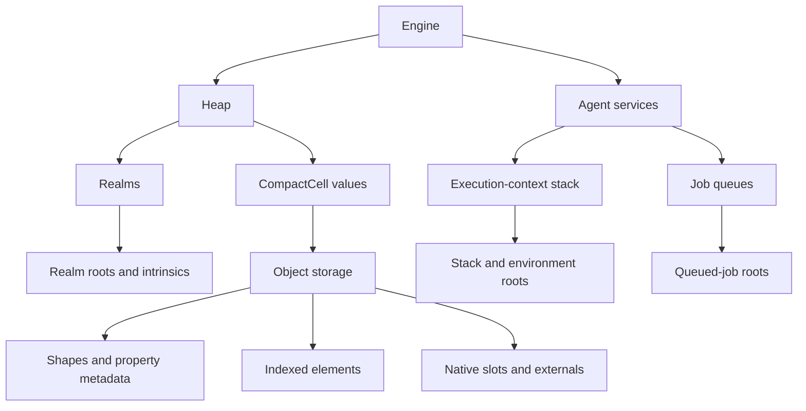
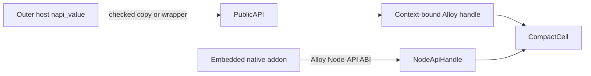

# Object model, CompactCell, and collector design

## Status and scope

This document defines target architecture and milestone interfaces. It is not
an assertion that CompactCell, ordinary objects, or a garbage collector are
implemented. The current runtime uses a `Value` enum and a Realm-owned heap
that is released as a unit.

Alloy owns the production runtime's value representation, object model,
collector, evaluator, built-ins, Realms, and execution-context stack. External
engines may remain useful differential-testing oracles, but their private value
layouts and collectors are not Alloy's storage model.

## Invariants

- A runtime value belongs to one Engine heap. Context/Realm ownership is
  validated whenever a value crosses an API boundary.
- CompactCell never embeds an unchecked process pointer. Heap references are
  validated handles or offsets whose width and encoding are target-specific.
- JavaScript-visible identity is stable across collection, including when the
  collector moves storage.
- The collector traces every strong edge and no unregistered host pointer.
- Native and host integrations use explicit roots; Rust lifetimes alone do not
  keep garbage-collected values alive.
- Write barriers are part of mutation APIs, not optional caller conventions.
- Finalizers never run while the heap is in an inconsistent tracing or moving
  phase and never execute JavaScript directly.
- Weak references and finalization are observably nondeterministic and cannot
  be used for correctness.
- Values from separate heaps are never compared by raw handle bits or inserted
  into one another's object graphs.
- CompactCell encoding is an implementation detail. Public Rust, NAPI, and
  future Node-API surfaces expose checked values/handles rather than tags.

## Ownership model



An Engine owns one heap and Agent-level services. A Context remains the public
Realm-facing handle. Realms own globals, intrinsics, module state, and host
state, while active execution contexts own temporary lexical environments,
operand stacks, and call frames.

Sharing immutable interned data between Engines is permitted only when that
data contains no heap references and has process-safe lifecycle management.

## CompactCell

CompactCell is the evaluator's copyable value slot. The semantic variants are
independent of their physical encoding:

- undefined, null, and booleans;
- Number, including NaN and signed zero;
- compact integers when the encoding permits, without creating a new
  ECMAScript type;
- Symbol or interned-literal identifiers;
- strong heap references;
- internal sentinels that can never escape as language values.

Candidate encodings must be selected per target after measurement:

| Target                     | Candidate                                              | Required validation                                      |
| -------------------------- | ------------------------------------------------------ | -------------------------------------------------------- |
| Native 64-bit              | 64-bit tagged/NaN-boxed cell or tagged handle          | Pointer assumptions, NaN payloads, sanitizer behavior    |
| Native 32-bit              | 32-bit tagged handle, or a two-word cell               | Number representation and maximum heap/index sizes       |
| Wasm32                     | 32-bit table index or two-word portable representation | Linear-memory growth, host references, Wasm GC evolution |
| Capability-pointer targets | Handle/table representation                            | Never truncate or reinterpret capabilities as integers   |

No design may assume that all 64-bit systems expose canonical 48-bit user
pointers. A handle-table encoding is the portability baseline even if a faster
native encoding is added later.

Conceptual operations:

```rust,ignore
trait CellCodec {
    type Cell: Copy;

    fn encode_primitive(value: Primitive) -> Self::Cell;
    fn encode_heap_ref(reference: HeapRef) -> Self::Cell;
    fn decode(cell: Self::Cell) -> DecodedValue;
}
```

The evaluator depends on semantic operations over decoded values, not on a
particular codec. Encoding changes must not alter `typeof`, equality, property
identity, or numeric behavior.

## Heap references and handles

`HeapRef` conceptually contains a heap identity plus an object-table slot and
generation. Implementations may compress this data when heap ownership is
already established by the containing structure.

Generation checks prevent stale handles from silently resolving after slot
reuse. Moving collection updates object-table entries rather than every
external handle. Interior pointers into movable objects are forbidden across
safepoints.

Context-bound external handles use a checked form:

```rust,ignore
struct ValueHandle {
    heap_id: HeapId,
    slot: HandleSlot,
    generation: Generation,
}

trait HandleScope {
    fn root(&mut self, value: CompactCell) -> LocalHandle;
}
```

Local handles die with their scope. Persistent handles require explicit
creation and release, and are reported as leaks during Engine shutdown tests.

## Ordinary objects

The first object representation separates identity from layout:

```rust,ignore
struct ObjectRecord {
    shape: ShapeId,
    prototype: Option<HeapRef>,
    slots: SlotStorage,
    elements: ElementStorage,
    flags: ObjectFlags,
}
```

Shapes describe property keys, slot indexes, and attributes. Shape transitions
are immutable and reusable. Dictionary mode handles deletion or highly dynamic
objects. Indexed elements use a separate dense/sparse strategy so array growth
does not destabilize named-property layout.

All property operations implement ECMAScript internal methods rather than
exposing storage directly:

```rust,ignore
trait ObjectInternalMethods {
    fn get_own_property(&self, key: PropertyKey) -> Completion<Option<Descriptor>>;
    fn define_own_property(&mut self, key: PropertyKey, desc: Descriptor)
        -> Completion<bool>;
    fn get(&self, key: PropertyKey, receiver: CompactCell) -> Completion<CompactCell>;
    fn set(
        &mut self,
        key: PropertyKey,
        value: CompactCell,
        receiver: CompactCell,
    ) -> Completion<bool>;
}
```

Property keys are String or Symbol. Interned literal IDs may accelerate lookup,
but ordinary String values must remain observably strings and must not become
Symbols.

## Built-ins and prototypes

Each Realm owns stable intrinsic identities and prototype relationships.
Standard constructors and globals retain standard names and semantics. Alloy
extensions are registered through explicit descriptors rather than a single
global `Alloy` namespace.

Built-in functions are ordinary callable objects with native code records.
Native slots are unforgeable heap metadata, not user-visible properties.
Prototype identity must remain stable for `new`, `instanceof`, and cross-call
method lookup.

## Collector

The initial collector should prioritize correctness and observability over
compactness:

1. Stop-the-world, single-Engine tracing collector.
2. Non-moving mark/sweep implementation to validate roots and barriers.
3. Generational or moving spaces only after handle-table and barrier tests are
   exhaustive.

Root categories:

- Realm globals, intrinsics, and module records;
- execution contexts, lexical environments, operand stacks, and pending
  completions;
- job and promise queues;
- local and persistent handle scopes;
- NAPI/Node-API references, wrapped native objects, and external finalizers;
- embedder-declared roots.

Every object layout supplies a trace implementation. Collector tests compare
declared edges with object-layout metadata so new fields cannot be added
without tracing coverage.

Mutation APIs call a barrier owned by the heap:

```rust,ignore
fn write_slot(owner: HeapRef, slot: SlotIndex, value: CompactCell, heap: &mut Heap) {
    heap.write_barrier(owner, value);
    heap.objects[owner].slots[slot] = value;
}
```

## Weak references and finalization

Weak handles are cleared only after strong tracing. Finalization jobs are
queued and run at a defined safe point on the Engine owner thread. Native
finalizers receive no implicit permission to execute JavaScript or resurrect
unrooted values.

Engine shutdown stops new work, drains or cancels jobs according to the public
contract, releases persistent handles, runs eligible native finalizers, and
then destroys Realms and heap storage. Shutdown ordering is tested explicitly.

## Host boundaries

Outer NAPI-RS values, future embedded Node-API `napi_value`s, and CompactCells
are distinct domains:



Object transfer initially uses context-bound handles or explicit structured
clone. It must not pretend that an embedded object is an ordinary object in
the outer Node/Bun Realm. External memory accounting and finalizers belong to
the owning Engine.

## Milestones and exit criteria

### M1: semantic object core

- Property keys, descriptors, ordinary objects, prototypes, and arrays.
- Reference operations route through object internal methods.
- Tests cover descriptor invariants, prototype lookup, deletion, arrays, and
  object identity.

### M2: functions and execution contexts

- Callable/constructable objects, closures, `this`, arguments, and return
  completions.
- Explicit execution-context stack and traced lexical environments.
- Stable intrinsic constructors and prototypes per Realm.

### M3: CompactCell codec

- Replace the evaluator-facing `Value` enum behind semantic APIs.
- Property and environment storage use CompactCell.
- Differential tests prove unchanged ECMAScript behavior on each target.
- Fuzzing validates decoding and rejects invalid/reserved bit patterns.

### M4: tracing collector

- Root registry, object tracing, mark/sweep, barriers, weak handles, and
  deterministic shutdown tests.
- Stress mode collects at every safepoint.
- Leak tests cover Realm disposal and persistent host handles.

### M5: optimization and portability

- Measure shape caches, generational collection, moving spaces, small-string
  storage, and target-specific codecs.
- Validate native 64-bit, native 32-bit where available, and Wasm32.
- Keep a portable handle-based codec as the reference implementation.

Encrypted or protected-memory experiments begin only after these milestones
establish ordinary tracing, rooting, finalization, threading, and shutdown
behavior.
